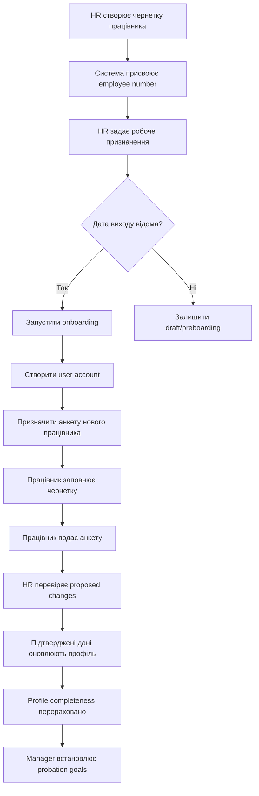
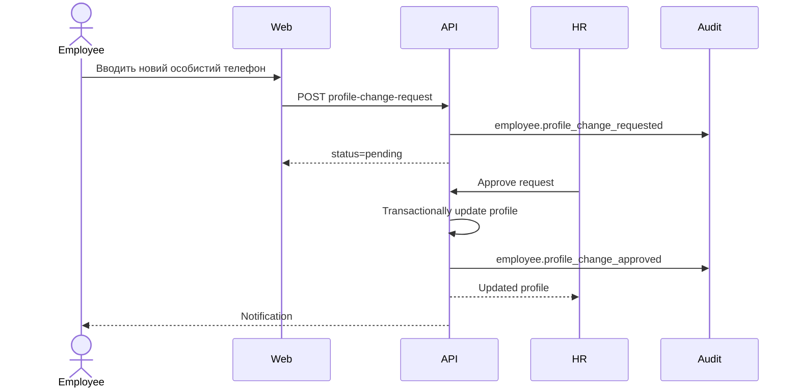

# Loom-CRM: Employee Profile Core та система анкетування працівників

> **TARGET / DRAFT — не статус імплементації.**  
> Це продуктові й технічне **бачення** (vision). Поточний стан коду: [hr-profile-roadmap.md](./hr-profile-roadmap.md) (living) і [architecture.md](../architecture.md). Hub: [docs/README.md](../README.md).  
> Не використовуйте цей файл як єдине джерело правди про те, що вже змерджено в LoomCRM.

> Продуктово-технічна специфікація розширеного профілю працівника, анкетування, онбордингу, оцінювання, розвитку та пов’язаних HR-процесів.

---

## Shipped in LoomCRM vs still planned

Короткий зріз (деталь — у roadmap). Оновлюйте roadmap при зміні коду; цей розділ — орієнтир читача спеки.

### Shipped (Phase 1 + Documents MVP)

- Organization Profile Core: `/people/:id`, section APIs (basic/contacts/personal/emergency/important-dates/assignments), capabilities, completeness, audit history API, employment history.
- UI вкладки зараз: **Дані працівника** (Основні · Контакти · Дати · Посада), **Відсутності**, **Документи**, **Показники** (stub), **Історія**, **Згодом** (stub).
- Absences як окремий бізнес-модуль (повний PW UI під `/absences/*`).
- Documents MVP: `employee_documents`, `documents.view` / `documents.manage`, People-вкладка + агрегат absence attachments; storage поки interim `content_base64`.
- Runtime ролі: `employee` · `department_manager` · `admin` (**немає** окремої ролі `hr`).

### Still planned (не плутати з «вже є»)

- Phase 2+: `/me` self-service, change-request queue.
- Questionnaires, Onboarding, Skills, Goals, Reviews як окремі модулі / вкладки з §8 цього документа.
- Platform **Files** (заміна base64), verification, consents versions.
- Окрема HR role у матрицях нижче — **продуктова** модель; у runtime її функції покриває Admin + permissions.

---

## Зміст

1. Призначення та поточний контекст
2. Проблема, цілі й продуктові принципи
3. Ролі, інформаційна архітектура та права доступу
4. Employee Profile Core і моделі даних
5. Questionnaires, Onboarding, Reviews, Goals, Skills, Documents
6. Backend, API та frontend-структура
7. UX, validation, audit, notifications, security
8. Міграції, testing, Definition of Done та roadmap
9. Мапінг 19 блоків анкети 360°
10. Додатки: ER-модель, workflows і каталог документації

---

## 1. Призначення документа

Цей документ визначає цільову структуру модуля управління працівниками в **Loom-CRM** та описує, як перетворити поточну картку працівника на центральний кадровий профіль компанії.

Документ створено на основі:

- поточної архітектури Loom-CRM;
- наявного модуля працівників і модуля відсутностей;
- анкети співробітника 360° з дев’ятнадцятьма тематичними блоками;
- потреб HR у створенні, оновленні та контролі кадрових даних;
- потреб керівників у доступі до робочої інформації, цілей, навичок і результатів працівників;
- потреб працівників у безпечному self-service редагуванні частини власного профілю.

Документ має слугувати:

1. продуктовим баченням;
2. функціональними вимогами;
3. технічним орієнтиром для backend і frontend;
4. основою для декомпозиції на задачі;
5. критерієм перевірки архітектурних рішень;
6. довгостроковою картою розвитку HR-частини Loom-CRM.

---

## 2. Короткий висновок

Анкета 360° не повинна бути перенесена в CRM як одна велика форма та не повинна зберігатися одним великим об’єктом у таблиці `employees`.

В анкеті одночасно змішані:

- постійні персональні дані;
- робочі та організаційні дані;
- конфіденційні HR-дані;
- добровільна інформація;
- дані для корпоративних активностей;
- професійний досвід;
- освіта;
- навички;
- кар’єрні очікування;
- цілі;
- індивідуальні плани розвитку;
- оцінювання керівника;
- онбординг;
- документи й доступи;
- згоди на обробку даних;
- контроль перенесення інформації до CRM.

Ці дані мають різний життєвий цикл, різних власників, різні правила доступу та різні вимоги до історії.

Правильна цільова модель:

```text
Employee Profile Core
├── постійна картка працівника;
├── робочі та організаційні призначення;
├── персональні й конфіденційні дані;
├── self-service запити на зміну даних;
├── історія змін;
└── інтеграція з іншими HR-модулями.

HR Business Modules
├── Questionnaires;
├── Onboarding;
├── Performance Reviews;
├── Goals & Development;
├── Skills;
├── Documents;
├── Consents;
├── Compensation;
└── Recruitment / Offboarding у майбутньому.
```

Першим етапом має бути **Employee Profile Core**. Анкетування, онбординг, оцінки та розвиток повинні будуватися навколо профілю, але не зливатися з ним в одну сутність.

---

## 3. Поточний контекст Loom-CRM

> Нижче — **цільовий** контекст для планування. Факт runtime і стрілки модулів: [architecture.md](../architecture.md) і [hr-profile-roadmap.md](./hr-profile-roadmap.md).

### 3.1. Архітектурний фундамент

Loom-CRM уже має базу, придатну для розвитку повноцінної HR-системи:

| Шар | Поточне рішення |
|---|---|
| Frontend | Angular у `apps/web` |
| Backend | NestJS у `apps/api` |
| Database | PostgreSQL 16 |
| API | REST з префіксом `/api/v1` |
| Shared contracts | `libs/contracts/*` |
| Архітектурний стиль | модульний моноліт |
| Схема БД | міграції, без TypeORM `synchronize` |
| Бізнес-модулі в коді | Absences; Documents (MVP) |
| Profile Core | Organization (`/people/:id`) — Phase 1 Done |

Цільова залежність модулів (актуально також Documents):

```text
Organization → Platform
Absences → Platform
Absences → Organization
Documents → Platform
Documents → Organization
Future modules → Platform
Future modules → Organization
```

Профіль працівника розвивається в межах `Organization`. Documents — окремий бізнес-модуль. Анкетування, онбординг, оцінювання та розвиток можуть бути подальшими бізнес-модулями з публічним API `Organization`.

### 3.2. Поточні архітектурні шари

```text
Platform
├── auth;
├── identity;
├── permissions;
├── audit;
├── notifications;
├── settings;
├── database;
├── bootstrap;
├── health;
└── files (planned — не shipped; documents MVP використовує interim content_base64).

Organization
├── employees (Profile Core);
├── departments;
├── positions;
├── schedules;
└── access scope.

Business modules
├── absences;
├── documents (MVP);
└── майбутні HR-модулі (questionnaires, onboarding, …).
```

### 3.3. Наслідки для нового функціоналу

Не потрібно створювати нову CRM з нуля. Потрібно:

- розширити `Organization`;
- не допустити перетворення `EmployeesService` на універсальний сервіс для всіх HR-процесів;
- використовувати наявні `Permissions`, `Audit`, `Notifications` і майбутній `Files`;
- зберегти Angular-клієнт відділеним від backend-сутностей;
- створювати API-контракти в `libs/contracts`;
- виконувати всі зміни схеми через міграції;
- інтегрувати профіль з Absences через публічні контракти.

---

## 4. Проблема, яку вирішуємо

### 4.1. Бізнес-проблема

Компанії потрібне одне місце, де HR може:

- створити працівника;
- внести кадрові дані;
- бачити, які секції заповнені;
- запросити працівника дозаповнити профіль;
- контролювати конфіденційність;
- бачити історію змін;
- вести онбординг;
- призначати анкети;
- зберігати цілі й оцінювання;
- контролювати документи;
- формувати кадрові звіти;
- не збирати інформацію в різних Excel-файлах, месенджерах і паперових формах.

### 4.2. Проблема користувача

Працівникові незручно:

- заповнювати довгу анкету за один раз;
- не розуміти, які поля обов’язкові;
- повторно вводити вже відомі CRM дані;
- не знати, хто побачить відповідь;
- не мати можливості зберегти чернетку;
- не розуміти, чи змінився офіційний профіль після подання анкети.

Керівникові незручно:

- шукати робочі дані серед конфіденційних;
- заповнювати загальну форму разом зі співробітником;
- не бачити історію цілей та оцінок;
- вручну нагадувати про випробувальний термін;
- працювати з однаковою матрицею навичок для різних посад.

### 4.3. Технічний ризик

Якщо всі поля додати до `employees`, виникнуть:

- сотні nullable-колонок;
- складні й небезпечні DTO;
- надмірні відповіді API;
- випадкове розкриття чутливих даних;
- неможливість вести історію анкет;
- неможливість вести кілька оцінювань;
- неможливість версіонувати питання;
- велика сторінка з важкою підтримкою;
- надто сильне зчеплення Organization з HR-процесами.

---

## 5. Цілі проєкту

### 5.1. Основні цілі

1. Створити центральний профіль працівника.
2. Розділити стабільні дані та історичні HR-процеси.
3. Забезпечити section-level або field-level права доступу.
4. Дозволити працівникові безпечно оновлювати власні дані.
5. Дозволити HR підтверджувати критичні зміни.
6. Дати керівнику робочий огляд своєї команди.
7. Створити основу для анкетування.
8. Створити основу для онбордингу.
9. Створити основу для performance review і розвитку.
10. Забезпечити аудит усіх важливих змін.
11. Зберегти модульну архітектуру Loom-CRM.
12. Забезпечити повну адаптацію інтерфейсу для desktop, tablet і phone.

### 5.2. Нецілі першого релізу

У перший реліз Employee Profile Core не обов’язково включати:

- повний конструктор анкет drag-and-drop;
- електронний підпис із КЕП;
- складний payroll;
- автоматичні інтеграції з банками;
- повний ATS / recruitment;
- 9-box talent matrix;
- складну компенсаційну аналітику;
- LMS;
- зовнішній кабінет кандидата;
- автоматичне розпізнавання документів;
- юридично значимий документообіг.

---

## 6. Продуктові принципи

### 6.1. Профіль не дорівнює анкеті

Профіль містить актуальний підтверджений стан. Анкета містить відповіді конкретної людини на конкретну версію запитань у конкретний момент часу.

```text
Профіль:
"Особистий телефон зараз: +380..."

Анкета:
"У відповіді від 24.07.2026 працівник повідомив новий номер +380..."
```

### 6.2. Актуальний стан не замінює історію

Зміна посади, відділу, керівника, грейду або зарплати повинна створювати історичний запис, а не просто перезаписувати колонку без сліду.

### 6.3. Чутливі дані не повертаються «про всяк випадок»

Backend повинен формувати відповідь відповідно до дозволів користувача. Frontend-приховування не вважається захистом.

### 6.4. Один власник даних

| Дані | Власник |
|---|---|
| ПІБ, employee number | Organization / Employees |
| Посада, підрозділ | Organization / Employment |
| Відпустки | Absences |
| Відповіді анкети | Questionnaires |
| Цілі | Goals |
| Оцінювання | Performance Reviews |
| Файли | Platform / Files + бізнес-власник metadata |
| Аудит | Platform / Audit |

### 6.5. Конфігурація замість дублювання

Перелік компаній, напрямків, посад, типів зайнятості, графіків, статусів і причин зміни не повинен бути жорстко зашитий у десятках Angular-компонентів.

### 6.6. Немає універсальної матриці навичок

Навички залежать від посади, напряму, підрозділу, рівня та типу роботи.

### 6.7. Немає однієї довгої форми

Великі дані редагуються секціями, а процеси виконуються кроками.

---

## 7. Користувачі та ролі

> **Runtime зараз:** `employee` · `department_manager` · `admin`. Окремої ролі `hr` немає — кадрові сценарії нижче покриває **Admin** (+ permissions). Розділ «HR / Admin» — продуктова модель для майбутньої декомпозиції прав, не окремий enum у БД.

### 7.1. HR / Admin

- створення профілю;
- внесення кадрових даних;
- перегляд конфіденційних секцій;
- підтвердження змін;
- запуск анкетування;
- контроль заповнення;
- ведення онбордингу;
- доступ до документів;
- експорт;
- аудит;
- управління довідниками.

### 7.2. Безпосередній керівник

- перегляд працівників у зоні відповідальності;
- перегляд робочих контактів;
- перегляд посади, графіка, статусу;
- встановлення цілей;
- проведення review;
- оцінка навичок;
- контроль випробувального терміну;
- виконання onboarding-задач.

### 7.3. Працівник

- перегляд власного профілю;
- заповнення дозволених секцій;
- подання змін;
- заповнення анкет;
- перегляд власних цілей;
- перегляд погоджених результатів review;
- завантаження документів;
- контроль власних згод;
- перегляд відсутностей.

### 7.4. Відповідальна особа

Приклади: бухгалтер, спеціаліст з охорони праці, IT-адміністратор, офіс-менеджер, наставник. Доступ надається до конкретного процесу, а не до повного профілю.

---

## 8. Інформаційна архітектура профілю

> **Цільова IA** нижче. **Фактичний UI `/people/:id` зараз:** Дані працівника · Відсутності · Документи · Показники (stub) · Історія · Згодом (stub). Див. [roadmap](./hr-profile-roadmap.md).

```text
Employee Profile
├── Header / Summary;
├── Overview;
├── Employment;
├── Personal Data;
├── Absences;
├── Onboarding;
├── Skills;
├── Goals & Development;
├── Reviews;
├── Documents;
├── Questionnaires;
├── History;
└── Administration.
```

Не всі вкладки мають бути видимі кожній ролі.

### 8.1. Шапка профілю

Шапка повинна показувати:

- фото;
- ПІБ;
- employee number;
- посаду;
- підрозділ;
- компанію або напрямок;
- статус;
- керівника;
- дату виходу;
- робочий email;
- робочий телефон;
- Telegram;
- короткі badges;
- профіль заповнений на N%;
- попередження про незавершені критичні дії.

Приклади badges:

```text
Активний
Випробувальний термін
Менеджер підрозділу
Профіль 74%
Документи: 2 відсутні
Review: очікується
```

### 8.2. Швидкі дії

Для HR:

- `Редагувати основні дані`;
- `Змінити призначення`;
- `Призначити анкету`;
- `Запустити онбординг`;
- `Додати документ`;
- `Сформувати PDF`;
- `Змінити статус`;
- `Архівувати`.

Для керівника:

- `Створити ціль`;
- `Провести review`;
- `Оцінити навички`;
- `Переглянути командний календар`.

Для працівника:

- `Оновити мої дані`;
- `Заповнити анкету`;
- `Додати документ`;
- `Переглянути мої відсутності`.

---

## 9. Детальна структура вкладок

### 9.1. Overview

Блоки:

1. **Основна інформація** — ПІБ, номер, посада, підрозділ, керівник, формат роботи.
2. **Контакти** — робочий телефон, email, Telegram.
3. **Поточний стан** — статус, дата прийняття, стаж, випробувальний термін.
4. **Відсутності** — поточна, наступна, залишки, pending request.
5. **Онбординг** — прогрес, прострочені задачі, відповідальні.
6. **Розвиток** — активні цілі, наступний review, навички, навчання.
7. **Якість профілю** — відсоток, відсутні поля, pending зміни.

### 9.2. Employment

Поля:

- company / legal entity;
- business direction;
- department;
- team;
- position;
- functional role;
- direct manager;
- department manager;
- mentor;
- HR responsible;
- workplace location;
- work format;
- schedule;
- employment type;
- contract type;
- start date;
- probation start;
- probation end;
- current employment status.

Поточне призначення не повинно бути єдиним джерелом історії.

```text
employment_assignment
├── employee_id
├── company_id
├── department_id
├── position_id
├── manager_id
├── employment_type
├── work_format
├── start_date
├── end_date
├── change_reason
└── status
```

### 9.3. Personal Data

Звичайні персональні дані:

- прізвище;
- ім’я;
- по батькові;
- preferred name;
- дата народження;
- місто проживання;
- бажана мова;
- фото;
- особисті контакти.

Робочі та особисті контакти треба розділяти.

```text
Робочі:
- corporate email;
- work phone;
- work Telegram.

Особисті:
- personal email;
- personal phone;
- personal Telegram.
```

Екстрений контакт — окрема захищена секція.

Добровільні поля:

- сімейний стан;
- інформація про дітей;
- домашні тварини;
- важливі дати;
- хобі;
- інтереси;
- розмір одягу;
- харчові особливості;
- формат подарунків;
- спосіб привітання.

### 9.4. Absences

Вкладка використовує модуль Absences та не дублює його дані. Кадровий статус `active` не змінюється на `vacation`.

### 9.5. Onboarding

- шаблон;
- дата старту;
- дата завершення;
- прогрес;
- задачі;
- відповідальні;
- дедлайни;
- блокери;
- коментарі;
- рішення після випробувального терміну.

### 9.6. Skills

- skill profile посади;
- самооцінка;
- оцінка керівника;
- підтверджений рівень;
- цільовий рівень;
- розрив;
- дата останньої оцінки;
- коментар;
- історія.

### 9.7. Goals & Development

- кар’єрні очікування;
- активні цілі;
- probation goals;
- quarterly goals;
- development goals;
- individual development plan;
- навчальні активності;
- наставник;
- прогрес;
- дедлайни.

### 9.8. Reviews

- upcoming review;
- completed reviews;
- review cycle;
- reviewer;
- employee self-review;
- manager review;
- agreed outcome;
- performance;
- potential;
- promotion readiness;
- strengths;
- development areas;
- recommendations.

### 9.9. Documents

- категорія;
- назва;
- файл;
- номер;
- дата видачі;
- дата завершення;
- статус перевірки;
- visibility;
- автор;
- дата завантаження;
- нагадування.

### 9.10. Questionnaires

- призначені анкети;
- статус;
- прогрес;
- дедлайн;
- хто заповнює;
- хто перевіряє;
- подані відповіді;
- proposed profile changes;
- історія версій.

### 9.11. History

Історія показує зрозумілі бізнес-події, але не розкриває значення, до яких користувач не має доступу.

---

## 10. Класифікація даних

| Рівень | Приклади |
|---|---|
| Public internal | ім’я, посада, робочий email |
| Team restricted | графік, робоча локація, керівник |
| HR confidential | особисті контакти, emergency contact |
| Highly confidential | зарплата, внутрішня оцінка, кадровий ризик |
| Legal / regulated | документи, згоди, медичні обмеження |
| Voluntary | діти, хобі, подарунки, харчування |

Для складних секцій бажано мати централізований mapping політик:

```ts
type EmployeeFieldPolicy = {
  field: string;
  sensitivity: 'internal' | 'confidential' | 'highly_confidential';
  canView: PermissionKey[];
  canEdit: PermissionKey[];
  canExport: PermissionKey[];
  employeeCanRequestChange: boolean;
  requiresApproval: boolean;
  auditMode: 'metadata_only' | 'old_and_new' | 'redacted';
};
```

---

## 11. Права доступу

Доступ визначається комбінацією:

```text
роль
+ permission
+ organizational scope
+ relationship to employee
+ sensitivity
+ process assignment
+ record state
```

Орієнтовні permissions:

```text
employees.read.basic
employees.read.work
employees.read.personal
employees.read.emergency_contact
employees.read.compensation
employees.read.hr_notes
employees.create
employees.update.basic
employees.update.work
employees.update.personal
employees.update.sensitive
employees.change_assignment
employees.change_status
employees.export
employees.view_history

questionnaires.manage_templates
questionnaires.assign
questionnaires.complete.self
questionnaires.complete.other
questionnaires.review
questionnaires.apply_profile_changes

onboarding.manage_templates
onboarding.start
onboarding.update_assigned_task
onboarding.complete
onboarding.view

reviews.create_cycle
reviews.complete.self
reviews.complete.manager
reviews.moderate
reviews.publish
reviews.read.confidential
```

Орієнтовна матриця:

| Дані / дія | Працівник | Прямий керівник | HR | Admin |
|---|---:|---:|---:|---:|
| Власні основні дані | читання | scoped reading | так | так |
| Редагування ПІБ | request | ні | так | так |
| Робочі контакти | власні | scoped | так | так |
| Особисті контакти | власні | ні | так | так |
| Emergency contact | власний | ні | так | так |
| Посада / відділ | читання | читання | зміна | зміна |
| Зарплата | за політикою | окремий дозвіл | так | так |
| HR note | ні | ні | так | так |
| Власні анкети | так | лише призначені | так | так |
| Manager review | published part | автор / scope | так | так |
| Кадровий ризик | ні | окремо | так | так |
| Документи | дозволені власні | категорійно | так | так |

---

## 12. Модель Employee Profile Core

### 12.1. Employee

```text
employees
- id uuid pk
- user_id uuid nullable unique
- employee_number text unique
- first_name text
- last_name text
- middle_name text nullable
- preferred_name text nullable
- profile_photo_file_id uuid nullable
- birth_date date nullable
- preferred_language text nullable
- city text nullable
- employment_status enum
- current_assignment_id uuid nullable
- profile_completion_percent integer
- created_at timestamptz
- updated_at timestamptz
- archived_at timestamptz nullable
```

Не потрібно додавати до `employees` усі відповіді анкети, дітей як JSON, історію посад, цілі, review, навички, документи або onboarding checklist.

### 12.2. Employee Contacts

```text
employee_contacts
- id
- employee_id
- type
- value
- is_primary
- visibility
- verified_at
- created_at
- updated_at
```

### 12.3. Emergency Contact

```text
employee_emergency_contacts
- id
- employee_id
- full_name
- relationship
- primary_phone
- secondary_phone nullable
- priority integer
- notes nullable
- is_active
- created_at
- updated_at
```

### 12.3.1. Important dates

Повторювані добровільні записи (назва + період). Не JSON у `employees`. Права — як personal (`canViewPersonal` / `canEditPersonal`). Write — єдиний replace-all:

```http
PUT /api/v1/employees/:id/important-dates
{ "dates": [{ "title": "...", "startDate": "YYYY-MM-DD", "endDate": "YYYY-MM-DD" | null }] }
```

```text
employee_important_dates
- id
- employee_id
- title
- start_date
- end_date nullable
- priority integer
- is_active
- created_at
- updated_at
```

UI: `/people/:id` → Дані → Дати (під фіксованими датами народження / акаунту / початку роботи).

### 12.4. Employment Assignment

```text
employment_assignments
- id
- employee_id
- company_id nullable
- direction_id nullable
- department_id
- team_id nullable
- position_id
- functional_role nullable
- manager_employee_id nullable
- mentor_employee_id nullable
- hr_responsible_employee_id nullable
- work_location_id nullable
- work_format
- employment_type
- contract_type
- schedule_id nullable
- start_date
- end_date nullable
- probation_end_date nullable
- status
- change_reason nullable
- created_by
- created_at
```

---

## 13. Система анкетування

Questionnaires — універсальний модуль для анкети нового працівника, анкети 360°, щорічного оновлення даних, self-review, exit interview і pulse survey.

Головні сутності:

```text
questionnaire_templates
questionnaire_template_versions
questionnaire_sections
questionnaire_questions
questionnaire_assignments
questionnaire_responses
questionnaire_answers
questionnaire_profile_change_proposals
```

### 13.1. Template і version

```text
questionnaire_template
- id
- code
- name
- description
- category
- is_active
- created_by
- created_at

questionnaire_template_version
- id
- template_id
- version
- status: draft | published | retired
- schema
- published_at
- created_at
```

Опублікований шаблон не можна безконтрольно змінювати, якщо вже є відповіді.

### 13.2. Question

```text
question
- id
- version_id
- section_id
- code
- label
- help_text
- type
- required
- order
- visibility_rule
- answerer_role
- validation
- profile_mapping nullable
- sensitivity
```

Типи питання:

```text
short_text
long_text
email
phone
number
date
single_select
multi_select
boolean
rating
skill_rating
table
file
consent
employee_reference
department_reference
position_reference
```

### 13.3. Assignment і статуси

```text
questionnaire_assignment
- id
- template_version_id
- subject_employee_id
- assigned_to_user_id
- assigned_role
- reviewer_user_id nullable
- status
- due_at nullable
- started_at nullable
- submitted_at nullable
- reviewed_at nullable
- created_by
- created_at
```

```text
draft
assigned
in_progress
submitted
changes_requested
reviewed
closed
cancelled
expired
```

### 13.4. Автозбереження

- debounce save;
- indicator `Збережено`;
- дата останнього успішного save;
- відновлення після перезавантаження;
- server validation при submit;
- часткова чернетка;
- контроль паралельного редагування.

### 13.5. Profile change proposal

Анкета не повинна автоматично змінювати офіційні кадрові поля.

```text
profile_change_proposal
- id
- employee_id
- source_response_id
- field_path
- current_value_snapshot
- proposed_value
- status
- reviewed_by
- reviewed_at
- rejection_reason
```

---

## 14. Onboarding

Онбординг — процес із задачами, відповідальними, строками та станом. Він не є набором checkbox у профілі.

```text
onboarding_templates
onboarding_template_tasks
onboarding_instances
onboarding_tasks
onboarding_comments
```

Типові задачі:

- отримати документи;
- створити користувача;
- створити корпоративну пошту;
- надати CRM-доступ;
- видати обладнання;
- підписати політики;
- пройти охорону праці;
- ознайомитися з командою;
- призначити наставника;
- пояснити роль;
- встановити probation goals;
- провести check-in першого тижня;
- провести probation review.

```text
onboarding_task
- id
- instance_id
- title
- description
- category
- assigned_to_user_id
- assigned_role
- due_at
- status
- completed_at
- completed_by
- evidence_file_id nullable
- blocked_reason nullable
- order
```

---

## 15. Performance Reviews

Кожне оцінювання — окремий історичний процес.

```text
review_cycles
review_instances
review_participants
review_sections
review_answers
review_summary
```

Типи review:

- probation 2 weeks;
- probation 1 month;
- probation final;
- quarterly;
- semiannual;
- annual;
- promotion;
- performance improvement;
- ad hoc.

Lifecycle:

```text
draft
→ launched
→ self_review
→ manager_review
→ calibration
→ discussion
→ acknowledged
→ closed
```

Окремо зберігати private manager notes, HR-only notes, shareable feedback і final published summary.

---

## 16. Goals & Development

### 16.1. Goal

```text
employee_goals
- id
- employee_id
- type
- title
- description
- success_criteria
- owner_id
- reviewer_id nullable
- mentor_id nullable
- start_date
- due_date
- status
- progress_percent
- source_review_id nullable
- created_by
- created_at
- updated_at
```

Типи цілей:

```text
probation
quarterly
performance
development
training
project
career
```

Статуси:

```text
draft
planned
active
blocked
completed
cancelled
not_achieved
```

Індивідуальний план розвитку має бути набором пов’язаних цілей і learning activities, а не одним великим текстом.

---

## 17. Skills

### 17.1. Каталог

```text
skill_groups
skills
position_skill_requirements
employee_skill_assessments
```

### 17.2. Position requirement

```text
position_skill_requirement
- position_id
- skill_id
- target_level
- required
- weight nullable
```

### 17.3. Assessment

```text
employee_skill_assessment
- id
- employee_id
- skill_id
- assessment_type: self | manager | confirmed
- level
- assessed_by
- assessed_at
- review_id nullable
- comment nullable
```

Рекомендована шкала:

| Рівень | Значення |
|---:|---|
| 0 | не володіє |
| 1 | бачив / знає базово |
| 2 | виконує з допомогою |
| 3 | виконує самостійно |
| 4 | виконує складні задачі |
| 5 | навчає інших |

---

## 18. Documents

Platform Files зберігає технічний файл. Business Document зберігає зміст:

```text
employee_document
- id
- employee_id
- file_id
- document_type_id
- title
- document_number
- issued_at
- expires_at
- status
- visibility
- verified_by
- verified_at
- metadata
```

Категорії:

- identity;
- employment;
- education;
- certificate;
- medical clearance;
- consent;
- safety;
- NDA;
- equipment;
- other.

Нагадування:

- expires in 60 days;
- expires in 30 days;
- expires in 7 days;
- expired;
- verification requested.

---

## 19. Consents

Анкета містить потенційні згоди:

- використання фото у внутрішньому профілі;
- корпоративне привітання;
- HR-повідомлення у вибраних каналах;
- обробка добровільної інформації;
- використання інформації про дітей для подарунків.

```text
employee_consents
- id
- employee_id
- consent_type
- policy_version
- status
- granted_at
- withdrawn_at nullable
- source
- evidence_file_id nullable
- recorded_by
```

Не потрібно зберігати лише `true/false`, якщо згоду можна відкликати або текст політики змінюється.

---

## 20. Compensation та грейди

### 20.1. Грейд

```text
grade_catalog
employee_grade_history
position_grade_range
```

### 20.2. Compensation

```text
employee_compensation_history
- employee_id
- amount
- currency
- period
- gross_or_net
- effective_from
- effective_to
- reason
- approved_by
```

Зарплата не повинна повертатися у звичайному `GET /employees/:id`. Потрібен окремий endpoint або окрема permission-aware projection.

---

## 21. Кадрові статуси

Рекомендовані статуси:

```text
draft
candidate
preboarding
probation
active
suspended
maternity_leave
military_leave
dismissed
archived
```

Не є кадровими статусами:

- vacation;
- sick leave;
- day off;
- business trip.

Зміна статусу повинна мати причину, effective date, audit event та не руйнувати історію заявок і документів.

---

## 22. Профільна повнота

`Profile completion` допомагає HR бачити якість даних.

Приклад ваг:

| Секція | Вага |
|---|---:|
| ПІБ і номер | 15 |
| Робоче призначення | 20 |
| Робочі контакти | 10 |
| Особисті контакти | 10 |
| Emergency contact | 10 |
| Фото | 5 |
| Документи | 15 |
| Onboarding | 15 |

Добровільні поля не повинні знижувати відсоток до 100%.

Краще показувати окремо:

- `core profile completeness`;
- `HR data completeness`;
- `documents completeness`;
- `onboarding progress`.

---

## 23. Редагування профілю

### 23.1. Секційне редагування

Кожна секція має:

- `Редагувати`;
- власну форму;
- власну валідацію;
- незалежне збереження;
- permissions;
- повідомлення про останню зміну.

### 23.2. Критичні операції

Окремі use cases:

- change employee number;
- change department;
- change position;
- change manager;
- change employment status;
- change salary;
- terminate employment;
- restore employee.

Їх не потрібно виконувати універсальним `PATCH /employees/:id`.

### 23.3. Self-service

Працівник може напряму редагувати малоризикові поля, подавати request на критичні поля, бачити статус request і відкликати request до розгляду.

| Поле | Модель |
|---|---|
| preferred name | direct edit |
| work Telegram | direct або approval |
| personal phone | approval |
| birth date | approval |
| department | недоступно |
| position | недоступно |
| emergency contact | direct або approval за політикою |

### 23.4. Conflict handling

Використовувати `updatedAt`, optimistic concurrency або version number та попередження про паралельну зміну.

---

## 24. Backend-структура

```text
apps/api/src/
├── platform/
│   ├── auth/
│   ├── identity/
│   ├── permissions/
│   ├── audit/
│   ├── notifications/
│   ├── files/
│   └── settings/
├── organization/
│   ├── employees/
│   │   ├── application/
│   │   ├── domain/
│   │   ├── infrastructure/
│   │   └── presentation/
│   ├── employment/
│   ├── departments/
│   ├── positions/
│   ├── companies/
│   ├── schedules/
│   └── organization.module.ts
└── modules/
    ├── absences/
    ├── questionnaires/
    ├── onboarding/
    ├── reviews/
    ├── goals/
    ├── skills/
    └── documents/
```

Не обов’язково негайно вводити повний DDD-каталог. Важливіше розділити controller, DTO, use case, policy, mapper, repository та entity.

### 24.1. Thin controllers

Controller:

- отримує DTO;
- отримує current user;
- викликає use case;
- повертає contract.

Controller не повинен:

- визначати scope вручну в кожному методі;
- збирати великий response;
- виконувати TypeORM queries;
- містити правила профільної повноти.

### 24.2. Policy service

```text
EmployeeProfilePolicy
- canViewSection(actor, employee, section)
- canEditSection(actor, employee, section)
- canExport(actor, employee, exportType)
- canApplyChange(actor, proposal)
```

### 24.3. Mapper

```text
EmployeeProfileMapper
- toBasicResponse
- toHrResponse
- toManagerResponse
- toSelfResponse
```

Альтернатива — один mapper із явною `projection`.

---

## 25. API

### 25.1. Основні endpoints

```http
GET    /api/v1/employees
POST   /api/v1/employees
GET    /api/v1/employees/:id
GET    /api/v1/employees/:id/profile
PATCH  /api/v1/employees/:id/basic
PATCH  /api/v1/employees/:id/contacts
PATCH  /api/v1/employees/:id/personal
PUT    /api/v1/employees/:id/emergency-contact
PUT    /api/v1/employees/:id/important-dates
GET    /api/v1/employees/:id/history
GET    /api/v1/employees/:id/completeness
```

### 25.2. Employment

```http
GET    /api/v1/employees/:id/employment
POST   /api/v1/employees/:id/employment-assignments
GET    /api/v1/employees/:id/employment-history
POST   /api/v1/employees/:id/status-transitions
```

### 25.3. Self-service changes

```http
GET    /api/v1/me/profile
PATCH  /api/v1/me/profile/preferences
POST   /api/v1/me/profile-change-requests
GET    /api/v1/me/profile-change-requests

GET    /api/v1/profile-change-requests
POST   /api/v1/profile-change-requests/:id/approve
POST   /api/v1/profile-change-requests/:id/reject
```

### 25.4. Questionnaires

```http
GET    /api/v1/questionnaire-templates
POST   /api/v1/questionnaire-templates
POST   /api/v1/questionnaire-templates/:id/versions
POST   /api/v1/questionnaire-template-versions/:id/publish

POST   /api/v1/questionnaire-assignments
GET    /api/v1/questionnaire-assignments/:id
PATCH  /api/v1/questionnaire-assignments/:id/draft
POST   /api/v1/questionnaire-assignments/:id/submit
POST   /api/v1/questionnaire-assignments/:id/request-changes
POST   /api/v1/questionnaire-assignments/:id/review
```

### 25.5. Onboarding

```http
POST   /api/v1/employees/:id/onboarding
GET    /api/v1/employees/:id/onboarding
PATCH  /api/v1/onboarding-tasks/:id
POST   /api/v1/onboarding-tasks/:id/complete
```

---

## 26. API response projections

### 26.1. List response

```ts
type EmployeeListItem = {
  id: string;
  employeeNumber: string;
  displayName: string;
  avatarUrl: string | null;
  position: ReferenceSummary | null;
  department: ReferenceSummary | null;
  manager: EmployeeSummary | null;
  status: EmployeeStatus;
  workContact?: WorkContactSummary;
};
```

### 26.2. Profile response

```ts
type EmployeeProfileResponse = {
  header: EmployeeProfileHeader;
  sections: {
    overview?: OverviewSection;
    employment?: EmploymentSection;
    contacts?: ContactsSection;
    personal?: PersonalSection;
    emergencyContact?: EmergencyContactSection;
    importantDates?: ImportantDateItem[];
  };
  capabilities: EmployeeProfileCapabilities;
  completeness: ProfileCompleteness;
};
```

`ImportantDateItem`: `{ id, title, startDate, endDate, priority }`.

### 26.3. Capabilities

```ts
type EmployeeProfileCapabilities = {
  canEditBasic: boolean;
  canEditEmployment: boolean;
  canViewPersonal: boolean;
  canViewEmergencyContact: boolean;
  canViewCompensation: boolean;
  canExport: boolean;
  canStartOnboarding: boolean;
  canAssignQuestionnaire: boolean;
};
```

Frontend не повинен сам здогадуватися про можливості. Backend усе одно повторно перевіряє права на mutation.

---

## 27. Frontend-структура

```text
apps/web/src/app/
├── core/
│   ├── api/
│   ├── auth/
│   └── permissions/
├── shared/
│   ├── ui/
│   ├── forms/
│   └── employee/
└── features/
    ├── employees/
    │   ├── pages/
    │   │   ├── employee-list-page/
    │   │   ├── employee-create-page/
    │   │   └── employee-profile-page/
    │   ├── components/
    │   │   ├── employee-profile-header/
    │   │   ├── employee-overview/
    │   │   ├── employee-employment-section/
    │   │   ├── employee-personal-section/
    │   │   ├── employee-contacts-section/
    │   │   ├── employee-profile-completeness/
    │   │   └── employee-history-timeline/
    │   ├── data-access/
    │   └── models/
    ├── questionnaires/
    ├── onboarding/
    ├── reviews/
    ├── goals/
    └── skills/
```

`employee-profile-page` повинна читати route, завантажувати profile shell, керувати tabs та відкривати dialogs. Вона не повинна містити тисячі рядків inline template і CSS.

Рекомендовано:

- Angular Reactive Forms;
- typed forms;
- окремі form mapper;
- server validation mapping;
- unsaved changes guard;
- reusable phone, date, employee picker, department picker;
- skeleton loading;
- error boundary на секцію.

---

## 28. UX анкетування

Анкета 360° має бути розділена на кроки:

```text
1. Основні дані
2. Контакти
3. Робота
4. Досвід та освіта
5. Навички
6. Стиль роботи
7. Розвиток
8. Добровільні дані
9. Перевірка та згоди
```

Правила UX:

- показувати орієнтовний час;
- дозволити зберегти й продовжити;
- показувати progress;
- не показувати HR-only секції працівнику;
- пояснювати мету добровільних питань;
- не ставити `Так / Ні / Не вказую` як три checkbox;
- використовувати radio для взаємовиключних значень;
- дозволяти dynamic rows;
- показувати валідацію біля поля;
- перед submit показувати summary;
- після submit забороняти тихе редагування;
- дозволяти HR request changes.

На телефоні:

- один стовпець;
- sticky bottom actions;
- великі touch targets;
- таблиці перетворюються на cards;
- progress доступний без горизонтального скролу;
- skill matrix має окреме мобільне представлення.

---

## 29. Validation

Загальні правила:

- trim;
- normalize empty to null;
- email validation;
- phone normalization;
- Telegram normalization;
- date constraints;
- future birth date forbidden;
- employment end >= start;
- probation end >= start;
- unique employee number;
- unique login email;
- controlled enum;
- references must exist and be active;
- manager cannot be the same employee;
- circular management should be blocked;
- duplicate active assignment should be blocked.

Conditional validation:

- `hasChildren = true` → можна додати children;
- `allergyStatus = yes` → description required;
- `status = dismissed` → effective date і reason required;
- `document requires expiration` → expiresAt required.

UI має розрізняти:

- обов’язково для створення;
- обов’язково для активації;
- обов’язково до першого дня;
- рекомендовано;
- добровільно.

---

## 30. Audit

Події:

```text
employee.created
employee.basic_updated
employee.personal_updated
employee.assignment_changed
employee.status_changed
employee.manager_changed
employee.profile_change_requested
employee.profile_change_approved
employee.exported
questionnaire.assigned
questionnaire.submitted
questionnaire.reviewed
review.published
document.viewed_sensitive
document.downloaded_sensitive
```

Для чутливих полів audit може зберігати факт зміни, field name, actor, time, reason, redacted old/new та correlation id.

Кожен PDF/CSV export з персональними даними повинен створювати audit event.

---

## 31. Notifications

Події:

- профіль потребує заповнення;
- працівник подав зміни;
- HR підтвердив або відхилив зміни;
- анкета призначена;
- дедлайн анкети наближається;
- анкета прострочена;
- onboarding task призначена;
- onboarding task прострочена;
- probation end наближається;
- review запущено;
- документ закінчується;
- ціль прострочена.

Канали:

- in-app;
- email у майбутньому;
- Telegram у майбутньому за наявності централізованої інтеграції.

---

## 32. Пошук, фільтрація та список працівників

### 32.1. Пошук

- ПІБ;
- employee number;
- email;
- phone;
- Telegram;
- position;
- department.

Sensitive personal search повинен бути обмежений.

### 32.2. Фільтри

- status;
- company;
- direction;
- department;
- position;
- manager;
- location;
- work format;
- probation ending;
- onboarding incomplete;
- profile incomplete;
- documents expiring;
- active / archived.

### 32.3. Saved views

У майбутньому:

```text
Нові працівники
Випробувальний термін цього місяця
Профіль < 80%
Прострочений онбординг
Документи закінчуються
```

---

## 33. Security та privacy

### 33.1. Мінімізація даних

Не збирати дані, якщо немає зрозумілої мети.

Особливо обережно працювати з:

- медичними даними;
- інформацією про дітей;
- сімейним станом;
- зарплатою;
- ризиком втрати;
- рекомендаціями керівника;
- документами.

### 33.2. Медичні дані

Зберігати лише те, що необхідно для безпечної організації праці.

Краще:

```text
Не піднімати вантажі понад X кг
```

ніж повний медичний діагноз.

### 33.3. Export

PDF повинен мати типи:

- basic profile;
- HR profile;
- work profile;
- employee copy;
- custom permitted export.

Не можна мати одну універсальну PDF, яка включає всі дані.

### 33.4. Retention

Потрібно визначити:

- скільки зберігати анкети;
- скільки зберігати документи;
- що відбувається після звільнення;
- що можна анонімізувати;
- що зберігається з юридичних причин.

---

## 34. Інтеграція з Absences

Absences може отримувати через Organization public API:

- employee id;
- display name;
- employee number;
- department;
- manager scope;
- schedule;
- employment status;
- calendar-safe projection.

Absences не має залежати від:

- personal contacts;
- children;
- salary;
- review;
- questionnaire;
- HR notes.

Історична заявка повинна зберігати submission snapshot, якщо це є бізнес-правилом. Новий профіль не повинен ламати минулі записи.

---

## 35. Міграції та база даних

### 35.1. Правила

- лише TypeORM migrations;
- ніякого `synchronize`;
- backward-compatible API під час rollout;
- міграції даних окремо від schema migration, якщо вони великі;
- індекси для employee search;
- foreign keys;
- soft archive замість cascade delete;
- timestamps у `timestamptz`;
- календарні дати у `date`.

### 35.2. Рекомендований порядок

1. Додати нові довідники.
2. Додати employment assignments.
3. Перенести поточне призначення.
4. Додати contacts / emergency contact.
5. Додати API projection.
6. Переключити frontend.
7. Після перевірки прибрати deprecated fields.

### 35.3. Індекси

```text
employees(employee_number)
employees(lower(last_name), lower(first_name))
employment_assignments(employee_id, status)
employment_assignments(department_id, status)
profile_change_requests(status, created_at)
questionnaire_assignments(assigned_to_user_id, status, due_at)
onboarding_tasks(assigned_to_user_id, status, due_at)
```

---

## 36. Data migration з наявної системи

Для кожного наявного поля визначити:

- current source;
- target entity;
- transformation;
- nullable policy;
- visibility;
- owner;
- verification status.

Оскільки спільний стан переноситься через PostgreSQL snapshot:

- після schema migration оновити restore flow;
- перевірити snapshot на новій схемі;
- не вважати snapshot міграцією;
- migration має працювати на будь-якій валідній БД;
- seed не повинен створювати конфліктні profile records.

Import report:

```text
total employees
migrated
warnings
invalid contacts
missing departments
duplicate employee numbers
orphan users
```

---

## 37. Accessibility

Вимоги:

- label для кожного input;
- keyboard navigation;
- visible focus;
- ARIA для accordion і tabs;
- error summary;
- достатній contrast;
- статус не передається лише кольором;
- великі touch targets;
- screen reader-friendly progress;
- responsive alternative для таблиць;
- date picker дозволяє ручний ввід;
- dialogs мають focus trap і повернення фокусу.

---

## 38. Performance

### 38.1. Не завантажувати весь профіль завжди

Можливі підходи:

- легкий profile shell + lazy tabs;
- section endpoints;
- conditional includes.

### 38.2. List

Employee list не повинен join усі questionnaires, documents і goals.

### 38.3. Timeline

History pagination:

```text
cursor
limit
event types
date range
```

### 38.4. Files

Файли не повертаються base64 у JSON.

---

## 39. Testing strategy

### 39.1. Backend unit tests

- permission policy;
- field projection;
- profile completeness;
- status transitions;
- change request approval;
- questionnaire validation;
- onboarding progress;
- skill gap calculation.

### 39.2. Integration tests

- create employee;
- unique employee number;
- personal fields hidden from manager;
- out-of-scope manager не отримує профіль;
- HR can view personal section;
- questionnaire submit creates immutable snapshot;
- approval updates profile;
- audit created after commit;
- rollback does not leave audit;
- assignment history correct.

### 39.3. Frontend tests

- tabs by capability;
- edit form validation;
- unsaved changes;
- mobile rendering;
- questionnaire autosave;
- section error;
- approval queue.

### 39.4. E2E — новий працівник

1. HR створює employee.
2. Система генерує employee number.
3. HR встановлює assignment.
4. HR запускає onboarding.
5. Працівник отримує анкету.
6. Працівник заповнює personal data.
7. HR підтверджує зміни.
8. Profile completeness оновлюється.
9. Manager ставить probation goals.
10. Наприкінці терміну запускається review.

### 39.5. E2E — зміна телефону

1. Працівник подає новий personal phone.
2. Старий номер не змінюється одразу.
3. HR бачить request.
4. HR підтверджує.
5. Профіль оновлюється.
6. Audit містить подію.
7. Інші ролі не отримують personal phone.

### 39.6. E2E — переведення

1. HR відкриває `Change assignment`.
2. Обирає новий department і position.
3. Встановлює effective date.
4. Попередній assignment закривається.
5. Новий стає active.
6. Manager scope змінюється з дати ефективності.
7. Absences history не змінюється.

---

## 40. Definition of Done

Feature вважається готовою, якщо:

- є міграція;
- є API contract;
- permissions реалізовані на backend;
- audit events визначені;
- UI адаптивний;
- loading, empty, error states реалізовані;
- validation на frontend і backend;
- немає витоку sensitive fields;
- є unit/integration tests;
- є документація;
- snapshot/restore перевірено;
- build, lint, typecheck і tests проходять;
- mobile acceptance виконано;
- старий workflow не зламано.

---

## 41. Етапи реалізації

### Етап 0. Discovery та фіксація політик

Результати:

- остаточний перелік ролей;
- список компаній/напрямків;
- employment statuses;
- матриця доступів;
- перелік чутливих полів;
- хто підтверджує self-service changes;
- що входить у PDF;
- retention policy;
- які блоки анкети потрібні реально.

### Етап 1. Employee Profile Core

Scope:

- profile header;
- overview;
- employment section;
- contacts;
- personal data;
- emergency contact;
- section-level edit;
- capabilities;
- audit;
- completeness;
- responsive UI.

Не включати full questionnaires, reviews, skills engine та compensation history.

### Етап 2. Self-service та change requests

- `/me/profile`;
- direct editable fields;
- approval workflow;
- HR queue;
- audit;
- notifications.

### Етап 3. Questionnaires MVP

- один seeded template 360;
- template version;
- assignment;
- draft autosave;
- submit;
- HR review;
- profile proposals.

Без UI-конструктора шаблонів.

### Етап 4. Onboarding

- templates;
- instance;
- tasks;
- roles;
- deadlines;
- progress;
- profile widget.

### Етап 5. Goals та probation review

- probation goals;
- manager review;
- employee visibility;
- reminders.

### Етап 6. Skills та development

- catalogs;
- position requirements;
- self/manager assessments;
- gap view;
- development goals.

### Етап 7. Documents та consents

- file metadata;
- access;
- verification;
- expiration;
- consent versions.

### Етап 8. Advanced HR

- compensation;
- grades;
- talent analytics;
- offboarding;
- recruitment;
- reports.

---

## 42. Декомпозиція першого етапу

### Epic 1 — Profile API projection

- define contracts;
- capabilities;
- basic mapper;
- list item;
- profile header;
- permissions tests.

### Epic 2 — Employment assignment

- schema;
- migration;
- service;
- history;
- change command;
- frontend section.

### Epic 3 — Personal data

- personal contacts;
- emergency contact;
- privacy policy;
- HR form;
- self view.

### Epic 4 — Profile UI shell

- page;
- header;
- tabs;
- responsive layout;
- skeleton;
- error states.

### Epic 5 — Audit and history

- events;
- timeline endpoint;
- UI;
- redaction.

### Epic 6 — Completeness

- rules;
- calculation;
- widget;
- employee list filter.

### Epic 7 — Self-service foundation

- `/me`;
- change request entity;
- employee form;
- HR approval queue.

---

## 43. Критерії приймання Employee Profile Core

### Загальні

- HR відкриває повний дозволений профіль.
- Manager бачить лише scoped employee.
- Manager out of scope не отримує sensitive data.
- Employee бачить власний профіль.
- Вкладки залежать від capabilities.
- Немає універсального response з усіма полями.
- Профіль працює на телефоні.

### Employment

- можна створити історичне призначення;
- поточне призначення однозначне;
- не можна мати два active assignments;
- manager не може бути сам собі;
- зміна створює audit.

### Personal

- personal contacts не видно іншим працівникам;
- emergency contact не входить у basic PDF;
- добровільні поля не required;
- HR може відредагувати;
- employee change може вимагати approval.

### History

- видно actor, action, date;
- sensitive values redacted;
- pagination працює.

### Completeness

- добровільні поля не знижують core score;
- missing fields показані;
- score оновлюється після зміни.

---

## 44. Мапінг анкети 360° до цільової системи

| Блок анкети | Куди переносити | Тип даних | Орієнтовний етап |
|---|---|---|---|
| 1. Особисті дані | Employee Profile / Personal | актуальний стан | 1 |
| 2. Сім’я та дати | Voluntary Profile / Questionnaire | добровільні | 3+ |
| 3. Екстрений контакт | Employee Profile / Confidential | актуальний стан | 1 |
| 4. Робота в компанії | Employment Assignment | актуальний + історія | 1 |
| 5. Грейд і зарплата | Grades / Compensation | історичні sensitive | 8 |
| 6. Професійний досвід | Questionnaire / Career Profile | історичні записи | 3/6 |
| 7. Матриця навичок | Skills | assessments | 6 |
| 8. Освіта та навчання | Education / Documents / Skills | повторювані записи | 6/7 |
| 9. Сильні сторони | Questionnaire / Reviews | snapshot | 3/5 |
| 10. Хобі | Voluntary Profile | добровільні | 3 |
| 11. Стиль роботи | Questionnaire | snapshot/preferences | 3 |
| 12. Безпека праці | Restricted HR / Safety | highly confidential | 7 |
| 13. Кар’єрні цілі | Goals & Development | історичні | 5/6 |
| 14. Цілі випробувального | Goals | історичні | 5 |
| 15. Оцінка керівника | Reviews | історичні confidential | 5 |
| 16. Онбординг | Onboarding | workflow | 4 |
| 17. Документи та доступи | Documents + Onboarding | workflow/files | 4/7 |
| 18. Згоди | Consents | versioned legal record | 7 |
| 19. Контроль внесення | Completeness + workflow | computed/process | 1/3 |

### 44.1. Блок 1 — Особисті дані

До постійного профілю:

- ПІБ;
- дата народження;
- місто;
- preferred name;
- мова;
- фото;
- контакти.

Необхідно розділити робочі та особисті контакти. Фото має мати окрему згоду або policy, якщо це потрібно компанії.

### 44.2. Блок 2 — Сім’я та важливі дати

Не робити обов’язковим. Інформація про дітей повинна бути повторюваною сутністю лише якщо компанія реально її використовує. Інакше залишити в questionnaire response і не переносити в profile.

**Важливі дати** — окрема таблиця `employee_important_dates` (title, start_date, optional end_date), API `PUT .../important-dates` (replace-all), проекція в `GET .../profile` → `sections.importantDates`. UI на вкладці «Дати» профілю `/people/:id`.

### 44.3. Блок 3 — Екстрений контакт

Захищена секція. Керівник не отримує доступ автоматично. Потрібно визначити, хто може використати контакт у надзвичайній ситуації.

### 44.4. Блок 4 — Робота в компанії

Перенести в employment assignment і довідники. Manager, mentor та HR responsible — references на employees, а не text fields.

### 44.5. Блок 5 — Грейд і зарплата

Відокремити від звичайного профілю. Грейд і compensation мають історію, effective dates і окремі permissions.

### 44.6. Блок 6 — Професійний досвід

Попередні місця роботи — repeating records або questionnaire snapshot. Не змішувати з поточним assignment.

### 44.7. Блок 7 — Матриця навичок

Матриця залежить від position skill profile. Самооцінка та manager assessment зберігаються окремо.

### 44.8. Блок 8 — Освіта та навчання

Освіта — repeating records. Сертифікат може мати документ, дату закінчення та status verification.

### 44.9. Блоки 9–11 — сильні сторони, хобі, стиль роботи

Переважно questionnaire/preferences. Дані можуть змінюватися, тому потрібна дата та джерело.

### 44.10. Блок 12 — безпека праці

Потребує окремого restricted access. Не зберігати повні діагнози без необхідності.

### 44.11. Блоки 13–15 — цілі та оцінювання

Це історичні процеси, а не статичні поля профілю.

### 44.12. Блоки 16–19 — onboarding, documents, consents, CRM control

Це workflow і computed state. Вони не повинні бути просто checkbox у `employees`.

---

## 45. Поля анкети, які треба переглянути

### 45.1. Checkbox, які мають бути radio або select

- сімейний стан;
- є діти;
- статус працівника;
- формат роботи, якщо дозволений лише один;
- тип зайнятості;
- тип оформлення;
- рівень освіти, якщо потрібен один найвищий;
- харчові особливості status;
- feedback frequency;
- productivity time;
- work style.

### 45.2. Поля, які потребують бізнес-уточнення

- «Компанія / напрямок» — одна чи декілька?
- «Функціональна роль» — довідник чи text?
- «Грейд G0–G5» — одна система для всіх посад?
- «ЗП на руки» — чи справді net і хто має доступ?
- «Медичний огляд пройдено» — потрібен документ чи лише дата?
- «Ключовий співробітник» — хто може бачити?
- «Ризик втрати» — чи показувати manager?
- «Рекомендація: попередження» — чи це performance process?
- «Харчові особливості» — строк зберігання?
- «Вітати публічно» — чи зберігати consent version?

### 45.3. Поля, які не повинні бути простим text

- manager;
- mentor;
- HR responsible;
- department;
- position;
- company;
- location;
- schedule;
- skill;
- document type.

Це references на довідники або працівників.

---

## 46. Рішення, які потрібно прийняти бізнесу

1. Які юридичні особи та напрями існують?
2. Чи може працівник одночасно належати до кількох напрямів?
3. Чи можливі кілька active assignments?
4. Хто є HR у permission model?
5. Чи HR і Admin — одна роль?
6. Які особисті поля бачить manager?
7. Чи employee бачить manager review повністю?
8. Чи існують HR-only notes?
9. Хто бачить зарплату?
10. Чи employee бачить власну зарплату в CRM?
11. Які зміни employee може робити без approval?
12. Хто підтверджує emergency contact?
13. Які дані входять у PDF?
14. Скільки зберігаються анкети?
15. Чи зберігаються дані дітей?
16. Чи потрібні документи, що підтверджують освіту?
17. Чи є одна шкала грейдів?
18. Чи review обов’язковий для всіх?
19. Які onboarding templates потрібні?
20. Які notification channels доступні?
21. Які поля є обов’язковими до активації працівника?
22. Чи потрібна окрема роль payroll accountant?
23. Хто може експортувати персональні дані?
24. Чи потрібне погодження керівника при переведенні?
25. Як обробляти працівників без системного user account?

---

## 47. Антипатерни

Не робити:

- `employees.profile_json` з усією системою;
- один `UpdateEmployeeDto` на 100 полів;
- один Angular component на 3000 рядків;
- перевірки `if role === admin` у кожному контролері;
- повернення salary і emergency contact у list endpoint;
- checkbox для взаємовиключних значень;
- hardcoded departments;
- видалення employee каскадом;
- перезапис review;
- редагування published questionnaire template;
- автоматичне перенесення анкети до профілю без review;
- використання absence як employee status;
- зберігання діагнозів без необхідності;
- одна PDF для всіх ролей;
- frontend-only privacy;
- audit до commit транзакції;
- notification до успішного commit;
- залежність Organization від Absences;
- прямий імпорт backend entities у Angular;
- використання snapshot як заміни міграції;
- відсутність історії при зміні assignment;
- зберігання одного спільного skill rating для employee і manager.

---

## 48. Майбутня аналітика

Після накопичення якісних даних:

- headcount;
- turnover;
- probation completion;
- onboarding duration;
- profile completeness;
- skill gaps;
- goals completion;
- review completion;
- promotion readiness;
- document expiration;
- team structure;
- manager span;
- training demand.

Аналітика повинна використовувати агрегати й permissions. Highly confidential дані не повинні потрапляти у звичайні dashboards.

---

## 49. Цільовий roadmap

```text
Phase 1
Employee Profile Core

Phase 2
Self-service + Approval

Phase 3
Questionnaires MVP

Phase 4
Onboarding

Phase 5
Goals + Probation Reviews

Phase 6
Skills + Development

Phase 7
Documents + Consents

Phase 8
Compensation + Grades + Analytics

Phase 9
Recruitment + Offboarding
```

Кожен phase повинен давати самостійну бізнес-цінність і не вимагати завершення всіх інших модулів.

---

## 50. Фінальна рекомендація

Найближча велика задача для Loom-CRM повинна називатися:

> **Employee Profile Core — центральний кадровий профіль працівника з секційним редагуванням, permission-aware відображенням, історією призначень, аудитом, profile completeness та основою self-service.**

Після неї:

> **Employee Questionnaires — версійовані шаблони, призначення, autosave, submit, HR review та контрольоване перенесення відповідей до профілю.**

Анкета 360° повинна використовуватися як:

- джерело вимог;
- перший шаблон Questionnaires;
- карта майбутніх HR-модулів;
- інструмент discovery з директором і HR.

Вона не повинна бути:

- однією таблицею;
- однією HTML-сторінкою;
- однією backend-сутністю;
- одним JSON-полем;
- єдиним профілем для всіх ролей.

---

# Додаток A. Орієнтовна ER-модель

```mermaid
erDiagram
    USER ||--o| EMPLOYEE : "may own"
    EMPLOYEE ||--o{ EMPLOYMENT_ASSIGNMENT : has
    EMPLOYEE ||--o{ EMPLOYEE_CONTACT : has
    EMPLOYEE ||--o{ EMERGENCY_CONTACT : has
    EMPLOYEE ||--o{ PROFILE_CHANGE_REQUEST : submits

    DEPARTMENT ||--o{ EMPLOYMENT_ASSIGNMENT : contains
    POSITION ||--o{ EMPLOYMENT_ASSIGNMENT : defines
    EMPLOYEE ||--o{ EMPLOYMENT_ASSIGNMENT : manages

    QUESTIONNAIRE_TEMPLATE ||--o{ QUESTIONNAIRE_TEMPLATE_VERSION : versions
    QUESTIONNAIRE_TEMPLATE_VERSION ||--o{ QUESTIONNAIRE_QUESTION : contains
    QUESTIONNAIRE_TEMPLATE_VERSION ||--o{ QUESTIONNAIRE_ASSIGNMENT : assigned
    EMPLOYEE ||--o{ QUESTIONNAIRE_ASSIGNMENT : subject
    QUESTIONNAIRE_ASSIGNMENT ||--o{ QUESTIONNAIRE_ANSWER : answers
    QUESTIONNAIRE_ASSIGNMENT ||--o{ PROFILE_CHANGE_PROPOSAL : proposes

    EMPLOYEE ||--o{ ONBOARDING_INSTANCE : has
    ONBOARDING_INSTANCE ||--o{ ONBOARDING_TASK : contains

    EMPLOYEE ||--o{ EMPLOYEE_GOAL : owns
    EMPLOYEE ||--o{ REVIEW_INSTANCE : receives
    REVIEW_INSTANCE ||--o{ REVIEW_ANSWER : contains

    SKILL ||--o{ POSITION_SKILL_REQUIREMENT : required
    POSITION ||--o{ POSITION_SKILL_REQUIREMENT : defines
    EMPLOYEE ||--o{ EMPLOYEE_SKILL_ASSESSMENT : assessed

    EMPLOYEE ||--o{ EMPLOYEE_DOCUMENT : owns
    FILE ||--o{ EMPLOYEE_DOCUMENT : stores
    EMPLOYEE ||--o{ EMPLOYEE_CONSENT : grants
```



---

# Додаток B. Workflow створення працівника



---

# Додаток C. Workflow зміни даних



---

# Додаток D. Рекомендований каталог документації

```text
docs/
├── product/
│   ├── employee-profile-core.md
│   ├── employee-profile-field-catalog.md
│   ├── questionnaires-spec.md
│   ├── onboarding-spec.md
│   ├── reviews-and-goals-spec.md
│   └── employee-data-privacy.md
├── dev/
│   ├── employee-profile-api.md
│   ├── employee-profile-database.md
│   ├── employee-profile-migrations.md
│   └── employee-profile-testing.md
└── adr/
    ├── employee-profile-boundaries.md
    ├── questionnaire-versioning.md
    └── sensitive-data-projections.md
```

---

# Додаток E. Наступні документи

Після погодження цієї специфікації доцільно створити:

1. `employee-profile-field-catalog.md`
   - повний перелік полів;
   - тип;
   - required;
   - sensitivity;
   - owner;
   - permissions;
   - validation;
   - export rules.

2. `employee-profile-api-contract.md`
   - endpoint;
   - request;
   - response;
   - errors;
   - capabilities.

3. `employee-profile-database-design.md`
   - таблиці;
   - constraints;
   - indexes;
   - migrations.

4. `employee-profile-ux-spec.md`
   - desktop;
   - tablet;
   - phone;
   - states;
   - forms;
   - dialogs.

5. `questionnaires-spec.md`
   - templates;
   - versions;
   - assignments;
   - answers;
   - review.

6. `employee-profile-implementation-plan.md`
   - epics;
   - tasks;
   - dependencies;
   - acceptance;
   - test plan.

---

# Додаток F. Джерела та контекст

- Repository: `https://github.com/Fours9/Loom-CRM`
- Architecture: `docs/architecture.md`
- Repository overview: `README.md`
- Backend root module: `apps/api/src/app.module.ts`
- Questionnaire prototype: `anketa_360.html`
- Target stack:
  - Angular;
  - NestJS;
  - PostgreSQL 16;
  - REST `/api/v1`;
  - TypeORM migrations;
  - modular monolith.
